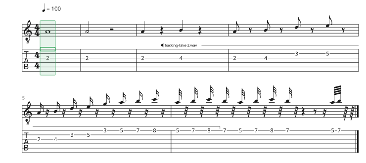

# oxiguitar-clips

Audio files played along with the score, for
[OxiGuitar](https://github.com/mateusrdp/oxiguitar): put a clip on a rest,
and it plays from that beat for as long as it lasts. For an intro, a
sample, a backing part or a placeholder for a part not written yet: not a
multitrack recorder.



- **The Clip tool** (the palette's Plugins section, or Plugins → Audio
  Clip…): with the caret on a rest, choose a file in the system's file
  dialog. WAV, FLAC, MP3 and Opus, the formats the
  audio export plugin
  writes. Click a clip on the page to change or remove it.
- **Its path**, chosen in the dialog and remembered: **relative to the
  score**, to move or share a folder holding the score, its `.oxg` file and
  the clips together (a zip, say); or **absolute**, to keep the clips where
  you work on them and move the score anywhere.
- **On the page**: a speaker and the file's name at the rest, then a line
  to the beat where the clip ends, across bars and systems, with the
  score's tempo changes. A clip that runs into the next clip of its track,
  or past a repeat, an ending or a D.C. (where the score goes elsewhere and
  the clip plays on), is laid in red; it still plays.
- **Played** through its track's volume, pan, mute and solo, after the
  track's instrument and effects, from wherever playing starts, through
  loops; and in audio exports. At a practice speed other than 100 % it
  keeps its pitch. A clip inside a repeat plays each time through.

The clip is kept on its rest beside the score, in its `.oxg` file: no
score format holds it. The track needs an instrument (the MIDI plugin plays
every track) for its clips to sound. A missing file is named in the footer
when the song is played or exported, and its track plays without it.

## Manual

The manual is at <https://mateusrdp.github.io/oxiguitar-clips/>. Its source is in [docs/manual](docs/manual). It covers what the plugin is for, how it works, what it needs and how to install it.

## Installing

Released builds come with OxiGuitar's packages and Flatpak repository
(`oxiguitar-clips`, `io.github.mateusrdp.OxiGuitar.Plugin.clips`), or as
`clips.oxp` files on this repository's releases: see
the [manual's install page](https://mateusrdp.github.io/oxiguitar-clips/install.html).
It needs OxiGuitar 0.21.4 or later (plugin interface 1.13).

## Building

`./build-oxp.sh` builds `dist/clips-VERSION-SYSTEM-ARCH.oxp`; `cargo test`
runs the unit tests, the contract suite against the built file, and the
real-time check of playing clips (nothing allocated on the audio thread,
at 100 % and away from it).

## Libraries

[Symphonia](https://github.com/pdeljanov/Symphonia) (WAV, FLAC, MP3;
MPL-2.0), [opus-pure](https://crates.io/crates/opus-pure) (Opus;
BSD-3-Clause), [Rubato](https://github.com/HEnquist/rubato) (resampling;
MIT), [timestretch](https://github.com/robmorgan/timestretch-rs) (the
practice speed with the pitch kept; MIT),
[rfd](https://github.com/PolyMeilex/rfd) (the file dialog; MIT) and
[pathdiff](https://crates.io/crates/pathdiff) (relative paths; MIT OR
Apache-2.0), each used as published.

## Testing

Every test, with one command (the manual's Testing page says more, and how to report a failure):

```sh
python3 scripts/test-all.py
```

## Licence

GPL-3.0-or-later. See LICENSE.
Contributions are welcome under the same terms; see
[CONTRIBUTING.md](CONTRIBUTING.md).
