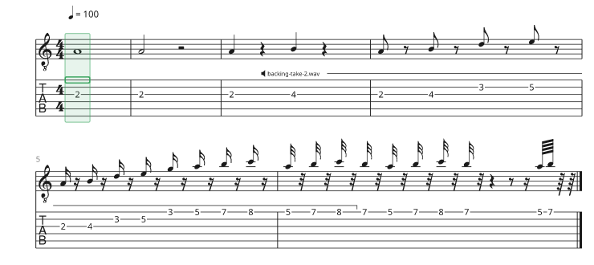

# Audio clips plugin

This plugin lets a score play recorded audio along with its notes. Put a clip on a rest, and from that beat the audio file plays for as long as it lasts, in time with the song. Use it for a spoken intro, a sample, a backing part you have as a recording, or a stand-in for a part you haven't written yet.

It is not a multitrack recorder: you can't record into OxiGuitar or edit the audio. You add a clip with the **Clip** tool, in the palette's Plugins section ([How to use it](use-cases.md)).

## Notes and audio, side by side

Everything else in OxiGuitar is *notation*: the score says which notes to play, and an instrument plugin turns them into sound when you press Play. Change the tempo and the notes simply come faster. A clip is different: it is already sound, a recording with its own length. The plugin's job is to fit the two together:

- **Where it starts** is a beat in the score, so the clip moves with the music if you change the tempo or add bars before it.
- **How long it lasts** is the recording's own length. The page draws a line from the rest to the beat where the clip ends, working out the beats from the score's tempo, tempo changes included.
- **Practice speed.** Slow the song to 70 % and the notes just play slower. Audio slowed down the naive way also drops in pitch, like a record played at the wrong speed. The plugin uses *time-stretching*, which changes the speed but keeps the pitch, so the clip stays in tune with the notes.
- **Sample rate.** A recording might be made at 44.1 kHz and your sound card run at 48 kHz. The plugin converts it, *resampling*, so it plays at the right speed and pitch.

A clip plays through its track: the track's volume, pan, mute and solo apply, and it goes into audio exports too.
