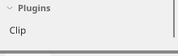
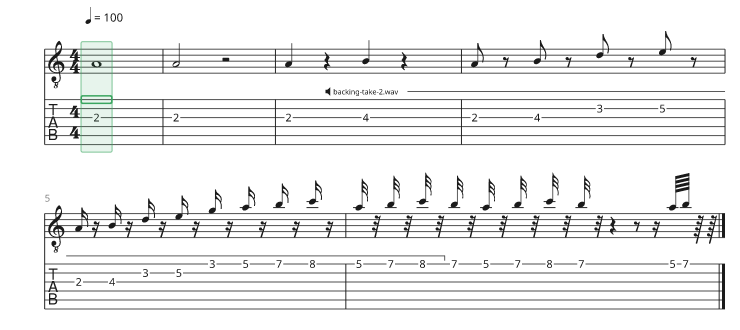

# How to use it

## Add a clip

1. Put the caret on a rest, in the track the clip should play through. A clip plays through its track's volume, pan, mute and solo.
2. Click **Clip** in the palette's **Plugins** section:

3. Choose a WAV, FLAC, MP3 or Opus file in the system's file dialog, and whether to keep its path **relative to the score** or **absolute**.
4. The page shows a speaker and the file's name at the rest, and a line to the beat where the clip ends:

Click the clip on the page to change or remove it.

## What you can do with it

- Put a clip on a rest. Choose a WAV, FLAC, MP3 or Opus file in the system's file dialog. Click a clip on the page to change or remove it.
- See it. The page shows a speaker and the file's name at the rest, then a line to the beat where the clip ends, across bars and systems.
- Hear it with the track. A clip plays through its track's volume, pan, mute and solo, from wherever playing starts, and through loops. It also goes into audio exports. At a practice speed other than 100 %, it keeps its pitch.
- Keep a clip with the score. Choose a path **relative to the score** to move or share a folder with the score, its `.oxg` file and the clips together. Choose **absolute** to keep clips where you work on them.

A clip that runs into the next clip of its track, or past a repeat or a D.C., is drawn in red. It still plays.

A missing file is named in the footer when the song is played or exported, and the track plays without it.
